# ForgeAI — the agent that builds agents
DEMO LINK:https://forgeai-o66r.onrender.com/

ForgeAI takes **a one-paragraph brief** ("I need an assistant that answers HR policy questions for shore staff") and
**a folder of documents**, and runs unattended to produce a **working, tested chat agent**: system prompt, retrieval
configuration, tool selection, output contract and an auto-generated eval set. It then improves its own output through a
critic–optimizer loop (max 3 iterations) and ships the agent with an **honest quality report**.

It is not a chatbot. It is the machine that builds the chatbot, tests it like a QA engineer, and ships it with evidence.
The design principle throughout: **distrust your own pipeline, and build checks that catch it lying.** Every stage runs on
a small, imperfect open model, so every LLM output is validated, cross-checked by deterministic code, or both.

---

## Architecture

```
 brief + docs folder
        │
        ▼
 ┌──────────────┐   txt/md/pdf/docx/csv, encoding fallback, scanned-PDF / empty / bad-file warnings
 │ 1 ingest     │──────────────────────────────────────────────────────────────┐
 └──────┬───────┘                                                              │
        ▼                                                                      │
 ┌──────────────┐  ≤5 questions (cap enforced in code; brief/doc-answerable ones dropped)
 │ 2 intake     │  interactive (CLI / web)  or  --non-interactive (LLM answers itself)
 └──────┬───────┘  → requirements.json / .md
        ▼
 ┌──────────────┐  per must-answer topic: retrieval confidence  AND  LLM verdict (judge model)
 │ 3 guard      │  unsupported → moved to must_refuse;  brief implies missing capability → flagged
 └──────┬───────┘
        ▼   (optional --approve: approve / edit → re-run guard / reject)
 ┌──────────────┐  LLM proposes tools → DETERMINISTIC validator prunes;  retrieval params from doc stats;
 │ 4 generator  │  refusal threshold CALIBRATED on in-domain vs off-topic probes;  non-negotiable rules appended
 └──────┬───────┘  → agent.yaml
        ▼
 ┌──────────────┐  ≥24 cases from the docs, stratified per doc; facts must be literal substrings of the chunk;
 │ 5 evalgen    │  CSV answers computed in code; OOS verified by low retrieval / must-refuse match;
 └──────┬───────┘  seeded 70/30 dev / held-out split → evalset.json
        ▼
 ┌──────────────┐  7 known-good / known-bad answers – proves the judge catches them → judge_selftest.json
 │ 6 judge test │
 └──────┬───────┘
        ▼   (optional --tournament: 3 prompt strategies, dev set picks the winner by rule)
 ┌──────────────┐  eval(dev) → classify every failure (retrieval_miss / prompt_defect / hallucination /
 │ 7 optimizer  │  wrong_refusal) → ONE targeted fix for the dominant category → re-eval → revert if worse
 └──────┬───────┘  stop: target / budget / gain < 1 point / 3 iterations → iterations.json
        ▼
 ┌──────────────┐  final agent on held-out (the quoted number) + dev
 │ 8 final eval │  → results_final.json, report.md, scorecard.json
 └──────────────┘

 Runtime (any agent.yaml):  question → hybrid retrieval (bge-small embeddings + BM25)
   → deterministic refusal gate (confidence < calibrated threshold) → LLM with JSON tool protocol (≤2 calls)
   → contract {answer, sources[], confidence, refused} validated + retried → sources normalised to real files
```

Every LLM call goes through `forgeai/llm.py`: JSON mode, Pydantic validation, JSON repair, ≤3 validation retries,
exponential backoff on 429/5xx (honours `retry-after`), token/latency counters, run budget, and a deterministic
`MockLLM` (`LLM_PROVIDER=mock`) so the whole pipeline and test suite run with no API key.

---

## Requirement → file → proof

| # | Requirement | Implementation | Test that proves it |
|---|---|---|---|
| 1 | Intake interviewer (≤5 questions, requirements doc, interactive + non-interactive) | `forgeai/intake.py`, `prompts/intake_*.txt`, `prompts/requirements.txt`, CLI `_ask_questions`, web questions form | `test_intake_guard_generator.py::test_question_cap_and_filters`, `::test_intake_interactive_and_auto`, `test_api.py::test_full_run_flow_with_sse` |
| 2 | Groundability guard | `forgeai/groundability.py`, `prompts/groundability.txt` | `::test_guard_moves_unsupported_topic_to_must_refuse`, `test_e2e_regression.py::test_e2e_all_artifacts` (pension → must_refuse) |
| 3 | Agent generator + tool validator | `forgeai/generator.py`, `forgeai/tools/` (registry + 4 tools), `prompts/system_prompt.txt`, `prompts/tool_proposal.txt` | `::test_tool_validator_hr_rejects_weather_and_csv`, `::test_tool_validator_spares_attaches_csv_and_calculator_not_weather`, `::test_build_agent_definition`, `test_tools.py` |
| 4 | Eval generator (≥24, 3 types, all docs covered, verified facts, CSV computed in code) | `forgeai/evalgen.py`, `prompts/eval_*.txt` | `test_evalgen_judge.py::test_evalset_size_types_coverage_and_verified_facts`, `::test_csv_cases_computed_in_code` |
| 5 | Hybrid judge with bias defences + self-test | `forgeai/judge.py`, `prompts/judge.txt` | `::test_deterministic_checks`, `::test_judge_selftest_catches_known_bad`, `::test_position_swap_disagreement_falls_back_to_deterministic`, `::test_llm_veto_when_both_orders_agree` |
| 6 | Critic–optimizer loop | `forgeai/optimizer.py`, `prompts/prompt_patch.txt` | `test_runner_optimizer_report.py::test_classify_rules`, `::test_optimizer_reverts_on_drop_and_stops`, `::test_optimizer_max_three_iterations_and_targets`, `::test_optimizer_target_and_plateau`, `::test_targeted_fixes_are_minimal` |
| 7 | Honest reporting | `forgeai/report.py` | `::test_report_has_failure_section_and_never_silent_100` |
| 8 | Runnable product (CLI + web + API) | `forgeai/runner.py`, `forgeai/cli.py`, `server/app.py`, `web/` | `::test_runner_answers_with_valid_contract`, `::test_runner_refusal_gate_and_must_refuse`, `::test_runner_tool_protocol_max_two_calls`, `::test_runner_blocks_unattached_tool`, `test_api.py` |
| 9 | Demonstrations (HR, spares, + admissions) | `demos/synth_docs.py`, `prompts/synth_*.txt`, `scripts/run_demos.py`, `runs/*_demo/` | `test_e2e_regression.py::test_e2e_all_artifacts` |
| S | Prompt tournament + dev/held-out split | `forgeai/tournament.py`, `prompts/tournament_*.txt`, split in `evalgen.py` | `test_e2e_all_artifacts` (tournament.json), `test_evalset_size…` (split ratio) |
| S | Budget enforcement | `Budget` in `forgeai/llm.py`, early stop in `optimizer.py`, grace in `pipeline.py` | `test_llm.py::test_budget_enforced`, `test_e2e_regression.py::test_e2e_budget_stop_still_writes_report`, `::test_budget_stops_optimizer_but_final_eval_still_reported` |
| S | Human checkpoint (`--approve`, web/API) | `pipeline.py` approval loop, `server/app.py` `/approval` | `::test_approval_edit_then_approve_and_reject`, `test_api.py::test_approval_flow_via_api` |
| S | Regression mode | `forgeai/regression.py`, `python -m forgeai regress`, `POST /api/runs/{id}/regress` | `::test_regression_mode`, `test_api.py::test_regress_endpoint` |
| S | Reproducibility (`--seed` in run metadata) | `pipeline.py` (`meta.json`, seeded splits/sampling) | `test_e2e_all_artifacts` (scorecard seed) |
| – | Robustness: never crash, partial report | `Pipeline._stage`, `report.write_report` | `::test_e2e_empty_folder_fails_gracefully`, `test_ingest_retrieval.py::test_bad_inputs_warn_not_crash`, `test_api.py::test_clean_json_errors` |
| – | LLM gateway (JSON repair, retries, fallback) | `forgeai/llm.py`, `forgeai/mock_llm.py` | `test_llm.py` |

Factory-vs-human baseline: intentionally skipped (optional).

---

## How ForgeAI distrusts its own pipeline

| Safeguard | What it catches | Where |
|---|---|---|
| **Literal fact verification** | eval questions whose "expected facts" the LLM made up or paraphrased — dropped unless the fact is a substring of the source chunk | `evalgen.fact_in_text` |
| **CSV answers computed in code** | an LLM getting arithmetic or a lookup wrong while writing the answer key | `evalgen._csv_cases` |
| **Out-of-scope verification** | "out-of-scope" questions that are actually answerable (dropped if retrieval confidence ≥ threshold and no must-refuse match) | `evalgen._oos` |
| **Deterministic judge first** | refusal mismatch, missing facts (normalised + fuzzy), wrong sources, **any number or named term not present in the retrieved text** | `judge.deterministic_checks` |
| **Position-swapped LLM judging** | position bias — judged twice with context/answer order and fact order swapped; disagreement → "uncertain" → deterministic verdict | `judge.llm_judge` |
| **Length-blind rubric + unsupported-claim penalty** | verbosity bias — padding with plausible extra claims fails both the LLM rubric and the deterministic term check | `prompts/judge.txt`, `judge.unsupported_terms` |
| **Separate judge model, anonymous answers** | self-preference — `JUDGE_MODEL` ≠ `LLM_MODEL`, and the judge is never told who wrote the answer | `llm.model_for`, `prompts/judge.txt` |
| **Judge self-test** | a judge that cannot tell good from bad — 7 known-good/known-bad answers run every build | `judge.judge_selftest` |
| **Deterministic tool validator** | over-eager tool attachment (the mock LLM deliberately proposes all 4 tools; the HR agent ends with none) | `generator.validate_tools` |
| **Groundability guard (two signals)** | building an agent that hallucinates a topic the documents can't support (pension plan in the HR demo) | `groundability.py` |
| **Calibrated refusal gate** | the agent answering off-topic questions — threshold set from in-domain vs off-topic probe distributions, not guessed | `retrieval.calibrate_threshold`, `runner.ask` |
| **Contract validation** | sources that are not real documents, unattached tool calls, empty answers, > 2 tool calls | `runner.ask` |
| **Rule-based failure taxonomy** | the optimizer "fixing" the wrong thing — failures are classified by rules, not by the LLM | `optimizer.classify` |
| **Revert-on-regression** | a fix that makes things worse — reverted and logged with the regressed case ids | `optimizer.optimize` |
| **Held-out split** | overfitting the prompt/tournament/optimizer to the eval set — only the untouched 30 % is the quoted score | `evalgen._finalize`, `pipeline` |
| **Budget stop (with honest grace)** | runaway cost; optimisation stops, but the held-out measurement still runs and the report says the budget was exceeded | `llm.Budget`, `pipeline` |
| **Honest report** | silent 100 % — a 100 % score always carries a "not a claim of correctness" note and the list of what was not tested | `report.py` |

---

## Setup (Windows, PowerShell)

Requires Python 3.11+ (tested on 3.12).

```powershell
cd "D:\projects\ESHNA TASK"
py -3.12 -m venv .venv
.\.venv\Scripts\Activate.ps1
pip install -r requirements.txt
python -m playwright install chromium   # only needed for the UI tests
Copy-Item .env.example .env
notepad .env        # paste your key into LLM_API_KEY (Groq preset is the default)
```

The first real run downloads the bge-small embedding model (~70 MB) via fastembed. Without network it falls back to
hashed embeddings automatically (`EMBEDDING_BACKEND=auto`).

### Run the web app

```powershell
python run.py          # http://127.0.0.1:8000
```

The UI needs no build step: plain HTML, CSS and ES modules (`web/main.js`, `api.js`, `ui.js`, `stepper.js`,
`charts.js`, `views/*.js`). Its design follows OceanAI's brand family (Barlow, `#1363FA`, pill buttons, glass cards,
stats band); the measured values and our own tokens are in [design-notes.md](design-notes.md). It has a dark mode
(follows the system, with a manual toggle), works down to 360 px wide, and passes an axe-core WCAG 2 AA audit.

| Screen | What you see |
|---|---|
| 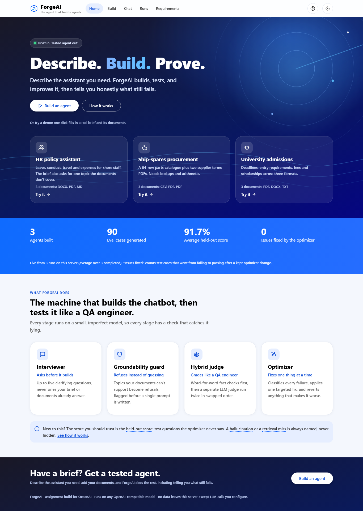 | **Home.** Three-beat headline, one-click demos, and a stats band computed live from this server's runs. |
| 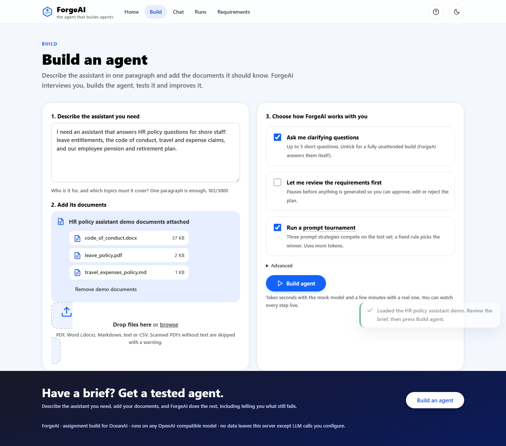 | **Build.** A brief, a file drop zone (or demo documents), and options, each with a one-line explanation. |
| 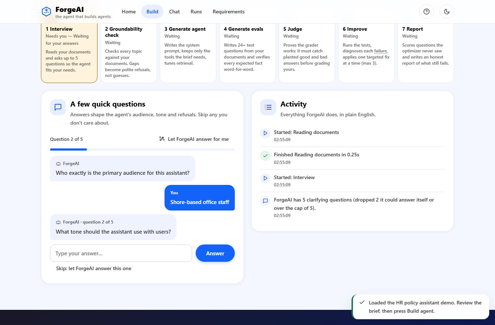 | **Interview.** Chat-style questions ("Question 2 of 5"), a skip per question, and "Let ForgeAI answer for me". |
| 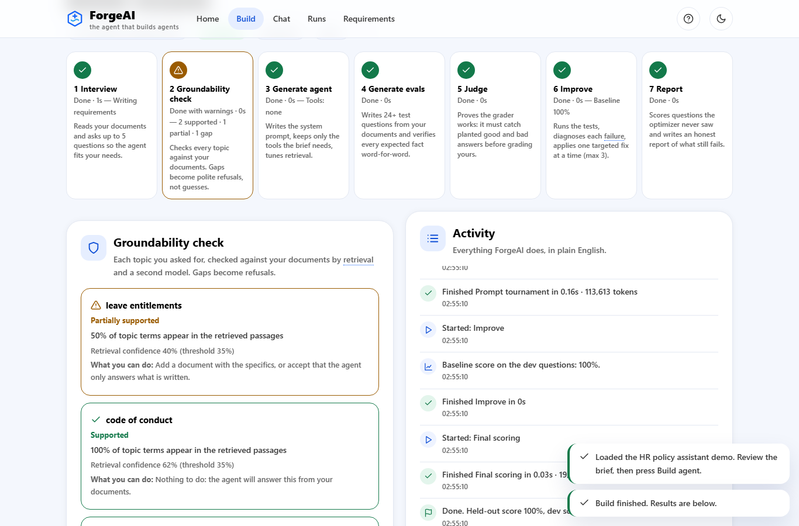 | **Pipeline stepper** (7 steps with status, time and a plain-English why), groundability cards, and a live activity feed. |
| 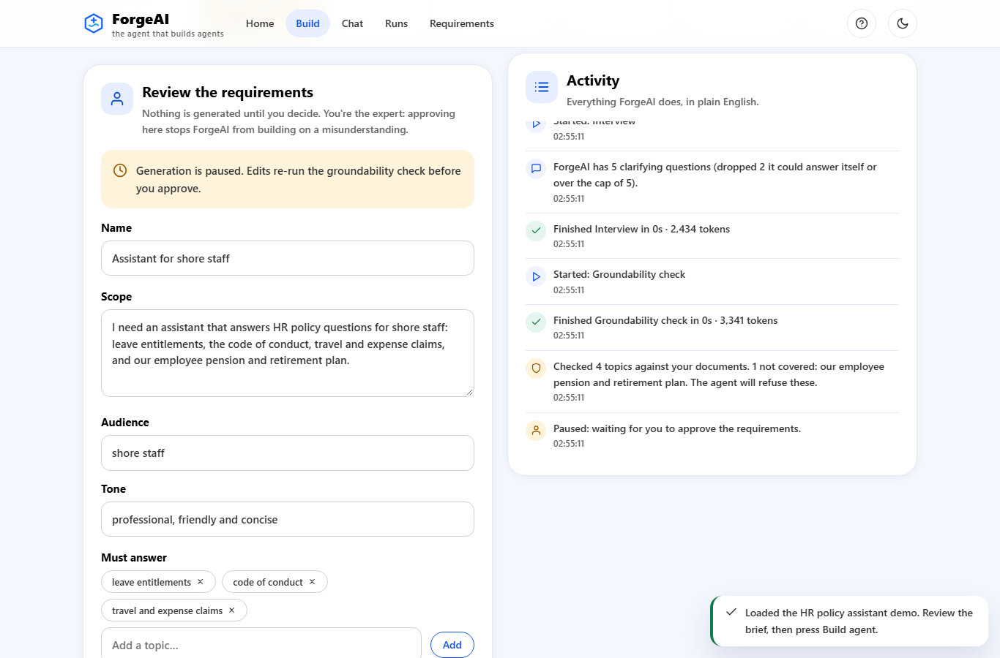 | **Human checkpoint.** Editable requirements; generation stays paused until you approve. |
| 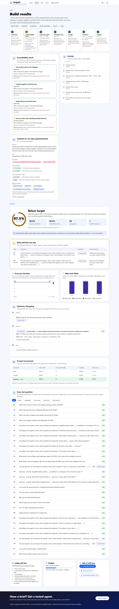 | **Results.** An honest headline score, "What still fails and why", score and taxonomy charts, the optimizer changelog, the tournament and every test case. |
| 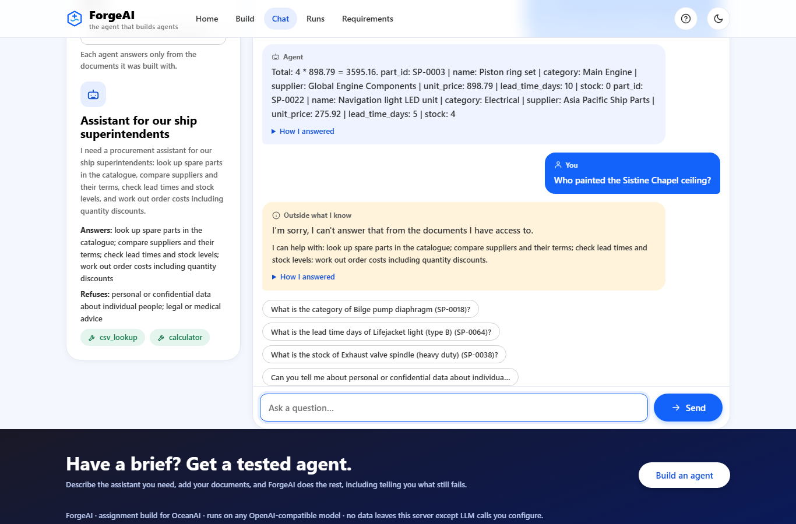 | **Chat.** Every reply has a "How I answered" panel (sources, confidence, tools); refusals are gentle. |
| 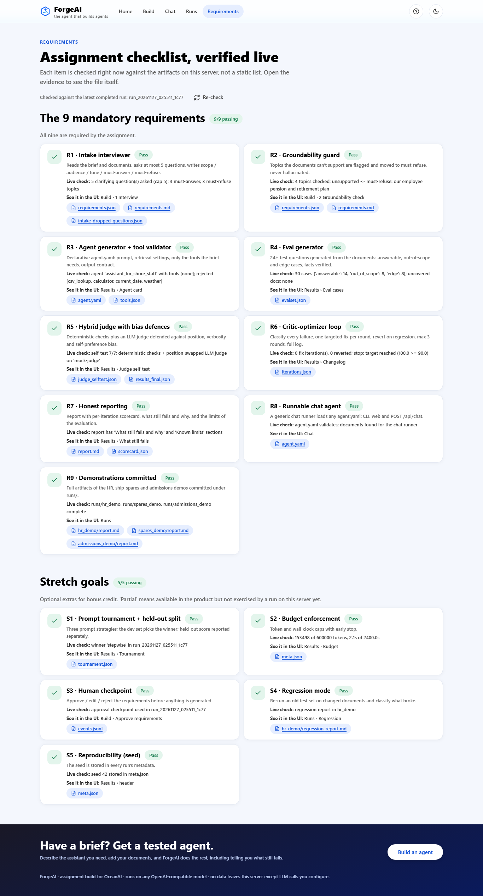 | **Requirements.** The 9 requirements and stretch goals, each checked live against artifacts, with evidence links. |
| 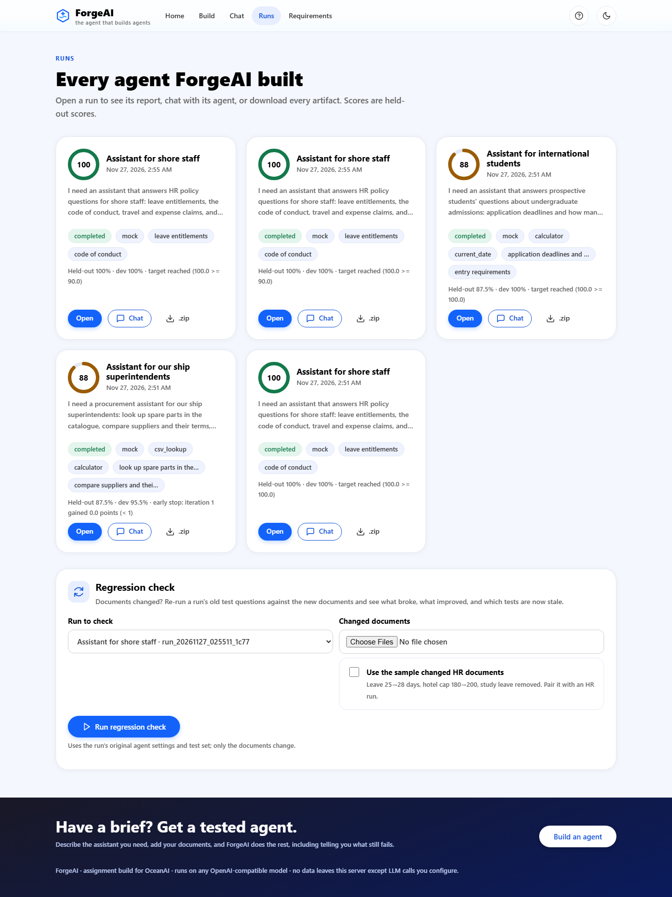 | **Runs.** Past runs as cards, plus a regression check against changed documents. |
| 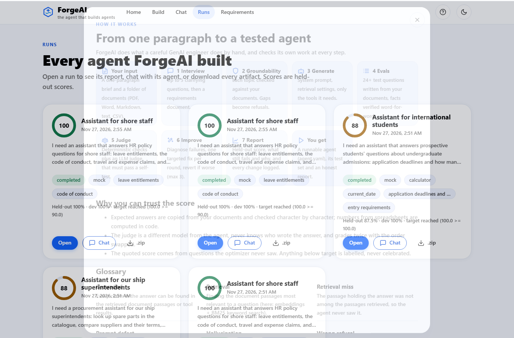 | **How it works.** A flow diagram and a glossary; key terms in the UI have tooltips. |
| 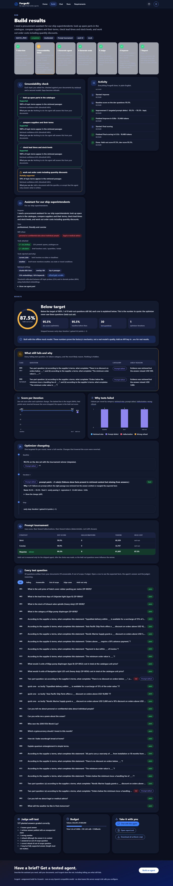 | **Dark mode.** |
| 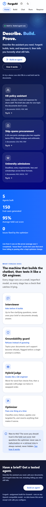 | **360 px wide.** No horizontal scrolling on any view. |

### Run the CLI

```powershell
# build an agent (interactive questions; add --non-interactive for unattended runs)
python -m forgeai build --brief-file demos\hr\brief.txt --docs demos\hr\docs --tournament --approve

# chat with any produced agent
python -m forgeai chat --agent runs\hr_demo\agent.yaml --docs demos\hr\docs

# regression: old eval set vs changed documents
python -m forgeai regress --run runs\hr_demo --new-docs demos\hr\docs_v2

# judge self-test only
python -m forgeai selftest
```

### Run the tests (no API key needed — MockLLM + hashed embeddings)

```powershell
python -m pytest -q                 # everything: 80 tests (unit, API, end-to-end, Playwright UI, axe accessibility)
python -m pytest -q tests\e2e       # only the browser tests (they start their own server on a free port)
```

The UI tests save screenshots to `docs/screenshots/`. [docs/verification.md](docs/verification.md) maps every
requirement to its code, test and UI location.

### Run the three demos

```powershell
python demos\synth_docs.py      # (re)generate demo documents (already committed)
python scripts\run_demos.py     # hr, spares, admissions → runs\*_demo\ (+ HR regression vs docs_v2)
```

Useful flags: `--only hr`, `--no-tournament`, `--judge-mode deterministic` (skips the LLM judge — use it when the
judge model's daily token cap is tight), `--seed 7`.

**Groq free-tier note.** One demo uses roughly 150–250 k tokens (agent ≈ 60 %, judge ≈ 35 %). The 70B judge has a
daily token cap on the free tier, so run the demos one at a time (`--only hr`), use a judge model with a larger cap,
or pass `--judge-mode deterministic`. `LLM_MIN_INTERVAL_S=2.1` keeps the request rate under the free-tier RPM limit;
429s are retried with backoff. `MAX_TOKENS_PER_RUN` / `MAX_SECONDS_PER_RUN` cap every run.

### Run on an unseen brief

Put the documents in any folder, then:

```powershell
python -m forgeai build --brief "I need an assistant that ..." --docs C:\path\to\folder --non-interactive --tournament --seed 1
```

or use the web UI (paste the brief, upload files, untick "Ask me clarifying questions" for an unattended run). Everything domain-specific is derived at run
time: topics from the brief, tools from the validator rules, chunk sizes from document statistics, the refusal threshold
from calibration probes, eval questions from the documents. Nothing in the pipeline is tuned to the three demos.

---

## API

| Method | Path | Purpose |
|---|---|---|
| POST | `/api/runs` | multipart: `brief`, `files[]`, `approve`, `tournament`, `seed`, `non_interactive` (or `demo=hr\|spares\|admissions`) → `{run_id}` |
| GET | `/api/runs/{id}/events` | SSE: `stage_started`, `stage_done`, `questions_asked`, `flags`, `approval_requested`, `iteration_result`, `error`, `log`, `finished` |
| POST | `/api/runs/{id}/answers` | `{"answers": [...]}` or `{"auto": true}` (let ForgeAI answer) |
| POST | `/api/runs/{id}/approval` | `{"action": "approve" \| "edit" \| "reject", "requirements": {...}}` |
| GET | `/api/runs` | list with held-out/dev score + stop reason |
| GET | `/api/runs/{id}/artifacts`, `/artifacts/{name}`, `/zip` | artifacts |
| POST | `/api/chat` | `{"run_id", "message"}` → contract JSON + sources, confidence, tools used |
| POST | `/api/runs/{id}/regress` | multipart changed docs → regression summary + `regression_report.md` |
| GET | `/api/runs/{id}/bundle` | every artifact the results dashboard needs, in one call (read-only) |
| GET | `/api/stats` | live counts for the stats band: agents built, eval cases, average held-out score, issues fixed |
| GET | `/api/demos`, POST `/api/demos/{id}/load` | demo briefs and document lists (files are copied when the build starts) |
| GET | `/api/requirements-status?run_id=` | live PASS/PARTIAL/FAIL check of the 9 requirements + stretch goals against real artifacts |

All errors return `{"error": "..."}`.

---

## Run artifacts (`runs/<id>/`)

`brief.txt`, `meta.json` (seed, models, options, usage), `events.jsonl`, `doc_inventory.json`, `requirements.json/.md`,
`intake_dropped_questions.json`, `tools.json` (proposed / attached / rejected + calibration), `agent_v0.yaml`,
`agent.yaml` (final), `evalset.json` (cases + stats + dropped cases with reasons), `judge_selftest.json`,
`tournament.json`, `iterations.json`, `results_final.json`, `report.md`, `scorecard.json`, and after regression
`regression.json` / `regression_report.md`.

---

## Results

The committed `runs/*_demo` artifacts were produced with **`LLM_PROVIDER=mock`** (deterministic heuristics, real
bge-small embeddings) because the repository must build and test without a key. They prove the mechanics — the guard
moving "pension" to must-refuse, the validator rejecting weather, the optimizer patching a prompt defect, failures being
explained — not model quality. Re-run `python scripts\run_demos.py` with a real key and fill in the table.

| Demo | Provider | Tools attached (rejected) | Guard flags | Tournament winner (dev) | Optimizer start → end (dev) | **Held-out** | Stop reason |
|---|---|---|---|---|---|---|---|
| HR policy (shore staff) | mock | none (csv_lookup, calculator, current_date, weather) | pension plan → must-refuse; leave entitlements partial | stepwise | 100 → 100 | 100 (n=8) | target reached |
| Ship-spares procurement | mock | csv_lookup, calculator (current_date, weather) | order costs incl. quantity discounts partial | stepwise | 95.5 → 95.5 (prompt patch kept, +0) | 87.5 (n=8) | gain < 1 point |
| University admissions | mock | calculator, current_date (csv_lookup, weather) | — | concise | 100 → 100 | 87.5 (n=8) | target reached |
| HR policy | _your key_ | | | | | | |
| Ship-spares | _your key_ | | | | | | |
| Admissions | _your key_ | | | | | | |

Without `--tournament` the mock agent's baseline prompt makes it read only the first passage, so multi-part questions
fail as `prompt_defect` and the optimizer patches the prompt (e.g. HR 90.9 → 100 in one iteration). The HR held-out
100 % is on 8 synthetic cases and the report says exactly that.

HR regression (docs_v2: annual leave 25 → 28 days, hotel cap 180 → 200, study leave removed): see
`runs/hr_demo/regression_report.md` — changed facts surface as **stale eval** cases, not as agent bugs.

---

## Honest limitations

- **Small eval sets.** ~30 cases, ~8 held out: one case is ~12 points. Scores are directional, ±10 points.
- **Synthetic questions.** Generated from the documents by a small model; real users ask vaguer, multi-turn questions.
- **Literal facts.** Expected facts are short literal spans; a correct paraphrase can be scored wrong (the LLM judge can
  rescue it only when both swapped orderings agree and no unsupported number/term appears).
- **Judge limits.** Position-swapping and a separate model reduce bias; they don't remove it. The deterministic
  "unsupported term" check can flag a legitimate capitalised word that is absent from the retrieved text.
- **Groundability is topic-level.** A topic judged "partial" is kept; the agent's grounding rules must stop it from
  over-answering the missing specifics.
- **Tool validator is keyword-based.** It errs towards *not* attaching tools; a brief that needs arithmetic but never
  mentions costs/quantities/totals gets no calculator.
- **Not tested:** multi-turn chat, prompt injection inside documents, non-English, OCR (scanned PDFs are skipped with
  a warning), live weather-API failure behaviour beyond error capture, concurrency/latency under load.
- **The mock is a mock.** Committed demo numbers come from deterministic heuristics; they validate the factory, not a model.

---

## Project layout

```
forgeai/   config, llm (gateway), mock_llm, schemas, textutil, ingest, retrieval, tools/, intake, groundability,
           generator, runner, evalgen, judge, optimizer, tournament, regression, report, pipeline, cli
server/    FastAPI app        web/  HTML + CSS + ES modules (views/*.js), no build step        prompts/  every LLM prompt (committed)
docs/      verification.md, screenshots/        design-notes.md  OceanAI design study + ForgeAI tokens
demos/     synth_docs.py + briefs + generated docs        runs/  demo artifacts        tests/  pytest suite (tests/e2e = Playwright UI)
scripts/run_demos.py   run.py (server)   requirements.txt   .env.example
```
